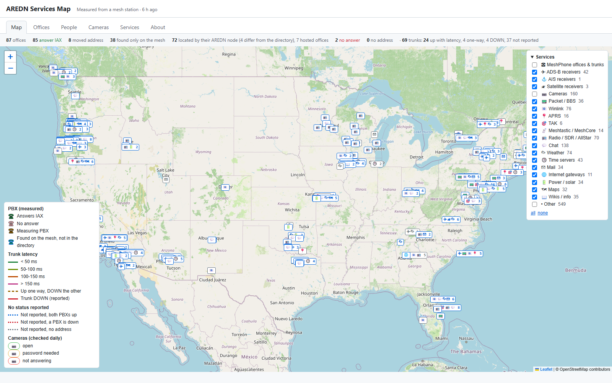

# AREDN Services Map

A map of what's on an [AREDN](https://www.arednmesh.org/) mesh network, checked from your own station:

- **MeshPhone offices and trunks.** Every PBX in the WT0F MeshPhone directory, placed at the AREDN node it sits behind, coloured by whether it answers an IAX2 POKE right now. PBXs found on the mesh but missing from the directory are added. Trunks show their latency, from the PBXs' own reports where they publish them.
- **People.** The MeshPhone white pages, with each person's office and location. Phones advertised on the mesh get a SIP OPTIONS ping, and everyone else shows whether their office's PBX answers.
- **Cameras.** Every camera or video stream advertised on the mesh, with a status (open, password needed or not answering) and what it is: a still image, live MJPEG, an RTSP stream or a web page. Where it can tell, it also names the software (motionEye, Frigate, Hikvision, Dahua, Reolink and so on) and the app that views it.
- **Every other service, by kind.** ADS-B and AIS receivers (including whether they publish an open `aircraft.json` / `ships.json` feed), satellite receivers, packet/BBS, Winlink, APRS, TAK, Meshtastic/MeshCore gateways, radio/SDR/AllStar, chat, weather, time servers (with an NTP query and stratum), mail, internet gateways, power/solar monitors, maps and wikis.

It's one small Python web app. Run it on any Linux box or Raspberry Pi that's on the mesh and open it in a browser.


*MeshPhone offices and trunks (coloured by latency) with cameras, measured from one station on the mesh.*



*The same map with the service kinds switched on: ADS-B, AIS, satellite, packet/BBS, Winlink, APRS, TAK, chat, weather, time servers and the rest.*

## What it sends, and how often

The checks make the same single request a visitor would make, never more:

| What | How | How often |
|---|---|---|
| Mesh host and service list | one sysinfo request to your AREDN node | once a day, with each pass |
| MeshPhone directory, white pages, trunk reports | one GET each, over the mesh | once a day |
| Each PBX | one IAX2 POKE (it answers PONG before any login) | once a day |
| Each person's phone on the mesh | one SIP OPTIONS | once a day |
| Each advertised service | one GET (web), one RTSP DESCRIBE (rtsp), one NTP request (time) or one TCP connect (anything else) | once a day |
| A dedicated camera host | TCP connects to the camera-app ports 554, 8554, 8000, 37777, 9000 and 34567, to say which app views it | once a day |
| ADS-B / AIS receivers | up to six GETs for the usual feed file locations | once a day |
| Each node's location | one sysinfo request | with the passes above |
| Place names (optional) | OpenStreetMap Nominatim, at most one per second, cached | only for new locations |

No credentials are tried. A camera link that carries a guest login is fetched as its owner advertised it, and the page shows that password masked.

## Install

Python 3.10 or newer.

```sh
git clone https://github.com/guywire/aredn-services-map.git
cd aredn-services-map
python3 -m venv .venv
.venv/bin/pip install .
cp config.example.yaml config.yaml      # then edit it
.venv/bin/aredn-services-map --config config.yaml
```

Open `http://<this box>:8088/`. Other paths:

- `/cameras/` opens the page on the cameras.
- `/aredn/` opens it on the services.
- `/health` shows how the background jobs are doing.

The first MeshPhone measurement runs about 2 minutes after start. The first services pass starts at 5 minutes; on a large mesh it takes 10 to 15 minutes, longer the first time if place names are on. Results are cached in `data_dir`, so a restart shows the last results at once.

To run it as a service, see `deploy/aredn-services-map.service`.

### The one setting that matters: `node_url`

The map needs a node whose `sysinfo` lists the whole mesh's hosts and services (`?hosts=1&services=1` is added for you). Check it in a browser: its `hosts` list should run into the thousands on a big mesh.

On the station where this was built, a supernode's `/a/sysinfo` lists everything. The station's own regular node, which reaches the mesh only through tunnels, listed just its own handful of hosts.

## Privacy and access

The white pages list other operators' names, numbers and contact details, which they published for the mesh. By default the app answers only direct requests from private or loopback addresses (the mesh is 10/8, plus your LAN), and it refuses anything that arrives through a reverse proxy.

`allow_internet: true` turns that check off. Only use it behind something that does its own authentication.

## Tests

```sh
.venv/bin/pip install '.[test]'
.venv/bin/pytest
```

## Licence

GPL-3.0-or-later (see `LICENSE`). This was extracted from the SignalMatrix / Emergency Communications Hub project. It bundles Leaflet 1.9.4 (BSD 2-Clause; see `NOTICE`).
