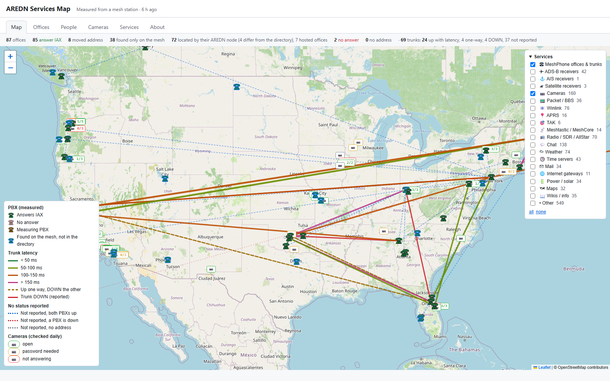

# AREDN Services Map

A map of what's on an [AREDN](https://www.arednmesh.org/) mesh network, checked from your own station:

- **MeshPhone offices and trunks.** Every PBX in the MeshPhone directory, placed at the AREDN node it sits behind, coloured by whether it answers an IAX2 POKE right now. PBXs found on the mesh but missing from the directory are added. Trunks show their latency, from the PBXs' own reports where they publish them.
- **People.** The MeshPhone white pages, with each person's office and location. Phones advertised on the mesh get a SIP OPTIONS ping, and everyone else shows whether their office's PBX answers.
- **Cameras.** Every camera or video stream advertised on the mesh, with a status (open, password needed or not answering) and what it is: a still image, live MJPEG, an RTSP stream or a web page. Where it can tell, it also names the software (motionEye, Frigate, Hikvision, Dahua, Reolink and so on) and the app that views it.
- **Every other service, by kind.** ADS-B and AIS receivers (including whether they publish an open `aircraft.json` / `ships.json` feed), satellite receivers, packet/BBS, Winlink, APRS, TAK, Meshtastic/MeshCore gateways, radio/SDR/AllStar, chat, weather, time servers (with an NTP query and stratum), mail, internet gateways, power/solar monitors, maps and wikis, CAD / dispatch, EOCs and agencies, file sharing, phones and PBXs, collaboration (Etherpad, Mattermost ...), ham tools and logging, mesh status and monitoring pages, network tests, and network gear (off by default). An owner's tag on the service name (`[cad]`, `[files]`, `[pbx]`, `[eoc]`, `[status]` ...) picks the kind exactly.

It's one small Python web app. Run it on any Linux box or Raspberry Pi that's on the mesh and open it in a browser.



*MeshPhone offices and trunks (coloured by latency) with cameras, measured from one station on the mesh.*


*The same map with the service kinds switched on: ADS-B, AIS, satellite, packet/BBS, Winlink, APRS, TAK, chat, weather, time servers and the rest.*

## What it sends, and how often

The checks make the same single request a visitor would make, never more:

| What | How | How often |
|---|---|---|
| Mesh host and service list | one sysinfo request to your AREDN node | with each pass (MeshPhone once a day, services every 6 h) |
| MeshPhone directory, white pages, trunk reports | one GET each, over the mesh | once a day |
| Each PBX | one IAX2 POKE (it answers PONG before any login) | once a day |
| Each person's phone on the mesh | one SIP OPTIONS | once a day |
| Each advertised service | one GET (web), one RTSP DESCRIBE (rtsp), one NTP request (time) or one TCP connect (anything else) | once a day, a quarter of the mesh every 6 h; not at all for a quarter another copy shared (only a spot-check sample) |
| A dedicated camera host | TCP connects to the camera-app ports 554, 8554, 8000, 37777, 9000 and 34567, to say which app views it | once a day |
| ADS-B / AIS receivers | up to six GETs for the usual feed file locations | once a day |
| Each node's location | one sysinfo request | with the passes above |
| Place names (optional) | OpenStreetMap Nominatim, at most one per second, cached | only for new locations |
| Other copies of this map | one small info GET each, then one GET for a quarter's result | before each quarter's turn |
| Map tiles | from the offline file or cache; else one GET per tile viewed, to the tile server or a copy on the mesh | only as people view the map |
| GitHub (optional) | one request for the latest release | once a day, when this box has internet |

No credentials are tried. A camera link that carries a guest login is fetched as its owner advertised it, and the page shows that password masked.

## Install

Python 3.10 or newer.

```sh
git clone https://github.com/guywire/aredn-services-map.git
cd aredn-services-map
python3 -m venv .venv
.venv/bin/pip install .
cp config.example.yaml config.yaml      # then edit it
.venv/bin/aredn-services-map --config config.yaml
```

Open `http://<this box>:8088/`. Other paths:

- `/cameras/` opens the page on the cameras.
- `/aredn/` opens it on the services.
- `/health` shows how the background jobs are doing.

The first MeshPhone measurement runs about 2 minutes after start. The first services pass, for one region, starts at 5 minutes and takes a few minutes on a large mesh (longer the first time if place names are on); the other regions follow 6 h apart. Results are cached in `data_dir`, so a restart shows the last results at once.

To run it as a service, see `deploy/aredn-services-map.service`.

### The one setting that matters: `node_url`

The map needs a node whose `sysinfo` lists the whole mesh's hosts and services (`?hosts=1&services=1` is added for you). Check it in a browser: its `hosts` list should run into the thousands on a big mesh.

On the station where this was built, a supernode's `/a/sysinfo` lists everything. The station's own regular node, which reaches the mesh only through tunnels, listed just its own handful of hosts.

## Sharing and regions

Services and cameras are checked a quarter of the mesh at a time, by the second number of the address of the node that advertises them:

| Region | Addresses |
|---|---|
| 1 | 10.0-63.x.x, 44.0-63.x.x |
| 2 | 10.64-127.x.x, 44.64-127.x.x |
| 3 | 10.128-191.x.x, 44.128-191.x.x |
| 4 | 10.192-255.x.x (44.192.0.0/10 isn't amateur space since 2019) |

AREDN makes its 10.x addresses from the radio's MAC address, so the four come out even: on the mesh this was built on, 1,149 / 1,113 / 1,026 / 1,192 hosts. 44-net (AMPRNet) addresses follow the same rule. One region is checked every `refresh_hours / 4` (6 h by default), so each is checked once a day and the load is spread across it. The Services tab shows each region, when it was checked and by whom.

Copies of this map on the same mesh share their results. Advertise yours on your node as a service named **AREDN Services Map** (a link to `http://<this box>:8088/`), and the others find it in the mesh's service list; or list them under `sharing.peers`. Before a region's turn, a copy asks the others what they have. If one checked that region in the last 4 hours, it uses that result instead of checking hundreds of services again.

A shared result is used only when all of this holds:

1. **Signed.** Each copy has its own Ed25519 key (`data_dir/identity.key`) and signs its results. The signature must verify over the exact text received. A key is pinned to its station name the first time it's seen (`data_dir/peers.json`), and a different key under the same name is refused. A copy passing along another's result keeps the original signature, so results can be relayed but not altered.
2. **Current.** It is for this region, under the same region scheme, checked within the last 4 hours, and not in the future.
3. **Nothing added.** Every entry must be a service this station's own node lists in that region right now, matched by advertising node, name and link. Names, links and categories come from our own list; only the measurements are taken from the peer, and only in the words this program writes itself (status, kind, software, viewer, ports, feed) with sane numbers and locations. Anything else is dropped.
4. **Complete.** It covers at least 90% of the region's services. The rest are checked here.
5. **Spot-checked.** A random sample (5%, at least 8, at most 30) is checked again from here, and at least 80% must agree: answering or not, and the node's location within 2 km. Services do come and go, so the bar isn't 100%. A result that fails isn't used, and its signer isn't trusted for 7 days.

Set `sharing.enabled: false` to neither ask nor answer.

## Map tiles without internet

The page gets its map tiles from this box (`/tiles/Z/X/Y.png`), not from the internet. Each tile comes from the first source that has it:

1. an offline tile file of your area (`tiles.mbtiles`, an MBTiles file);
2. this box's tile cache (tiles it has served before);
3. the internet tile server (`tiles.url`, OpenStreetMap by default), when this box has internet;
4. other copies of this map on the mesh, which answer only from their own offline file and cache.

So one box with internet, or with an offline file, gives everyone on the mesh a map. OpenStreetMap's tile servers are run by volunteers: this fetches only tiles somebody views, caches them for 30 days and never pre-fetches. For heavier use, set `tiles.url` to your own or a commercial tile server, or provide an MBTiles file.

More shared layers (ADS-B and AIS from the mesh's receivers, MeshPhone status, APRS, weather) are planned the same way: see [docs/SHARING.md](docs/SHARING.md).

## Updating

Once a day the map checks GitHub for a newer release (when the box has internet) and the page shows "Update available". To install it:

```sh
.venv/bin/aredn-services-map --update
sudo systemctl restart aredn-services-map
```

Or set `updates.auto_install: true` and it installs the new release and restarts itself. A git checkout (the install above) is fast-forwarded to the release tag, and is left alone if it has local changes. Any other install gets the release's source archive from GitHub, checked to unpack only inside its own folder and to be the version the release names. Then `pip install` picks up any new dependency. Nothing runs as root.

Each release also carries a source tarball with a signed SLSA provenance statement, made by GitHub Actions. To verify a download by hand, use [slsa-verifier](https://github.com/slsa-framework/slsa-verifier):

```sh
slsa-verifier verify-artifact aredn-services-map-0.2.0.tar.gz   --provenance-path aredn-services-map-0.2.0.tar.gz.intoto.jsonl   --source-uri github.com/guywire/aredn-services-map --source-tag v0.2.0
```

## Privacy and access

The white pages list other operators' names, numbers and contact details, which they published for the mesh. By default the app answers only direct requests from private, loopback or AMPRNet addresses (the mesh is 10/8, sometimes the amateur part of 44-net, 44.0.0.0/9 and 44.128.0.0/10, plus your LAN), and it refuses anything that arrives through a reverse proxy.

`allow_internet: true` turns that check off. Only use it behind something that does its own authentication.

## Tests

```sh
.venv/bin/pip install '.[test]'
.venv/bin/pytest
```

## Licence

GPL-3.0-or-later (see `LICENSE`). This was extracted from the SignalMatrix / Emergency Communications Hub project. It bundles Leaflet 1.9.4 (BSD 2-Clause; see `NOTICE`).
